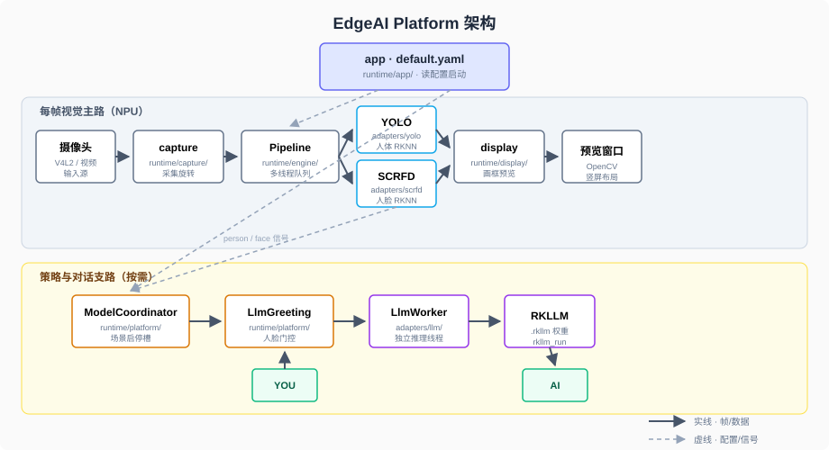

🌐 Language: **English** | [中文](README.zh.md)

# EAI-RK3588: Plugin-Based Edge AI Platform

EAI-RK3588 is an extensible edge inference platform for Rockchip RK3588 / RK3588S. It is driven by a single YAML configuration file and combines a multi-threaded video pipeline with a plugin-based architecture. Built-in YOLO and SCRFD models, plus local RKLLM dialogue and MeloTTS speech synthesis. The default application demonstrates the complete loop of person detection → face recognition → automatic greeting → voice conversation, with per-frame vision inference decoupled from the LLM/TTS side-path threads so they do not block each other.

Verified on ALIENTEK RK3588 and Firefly LubanCat RK3588 / RK3588S.

<video src="https://github.com/user-attachments/assets/ecccc336-8c3d-47c2-b277-298a9b517630" controls width="100%"></video>

## Board Adaptation

Inference runs on Rockchip rknpu and is common across the RK3588 / RK3588S series. The code itself does not depend on a specific board. When porting, adjust the items directly related to the code according to the board, including the camera device node, camera model, speaker and toolchain; the rest is common.

> The rknpu / MPP / RGA drivers for RK3588 exist only in vendor BSP kernels. Use the official image / BSP kernel from ALIENTEK or LubanCat; a standard mainline kernel does not include these drivers.

| Item | Notes |
|---|---|
| Camera device node | Use `ls /dev/video*` to find the actual node on the board, then set `input.source` |
| Camera model | Tested with MIPI IMX415 and OV8858 |
| Speaker / audio output | Audio devices may differ between boards; adjust according to the system configuration |
| Toolchain | Cross toolchain and sysroot differ between vendors; replace the toolchain path and sysroot in `build-linux.sh` |

Verified combinations:

- ALIENTEK RK3588 + MIPI IMX415
- Firefly LubanCat RK3588 / RK3588S + MIPI IMX415 / OV8858

Other RK3588 / RK3588S boards such as Orange Pi have not been tested; refer to the scripts when porting.

## Quick Start

Make sure the `.rknn` and `.rkllm` model files are placed under `model/`. If `.rkllm` is missing, the application automatically falls back to vision-only mode.

Run the pre-flight checks from the repository root:

```bash
python3 tools/check_config.py    # validate YAML field types and ranges

./tools/check_models.sh          # check that model files are in place
```

Then enter runtime/ to build and deploy:
```bash
# 1. Enter the runtime directory
cd runtime

# 2. Run the cross-compilation script (uses the ALIENTEK toolchain)
./build-linux.sh

# 3. Push the build output to the board (to /userdata/aidemo; adjust the path as needed)
adb push install/rk3588_linux_aarch64/rknn_eai_rk3588 /userdata/aidemo

# 4. Enter the board directory and run
cd /userdata/aidemo/rknn_eai_rk3588
./edgeai_app
```

The commands above use the ALIENTEK toolchain. For LubanCat or other RK3588 / RK3588S boards, adjust the toolchain path, camera node and speaker as described in the previous section; the remaining steps are unchanged.

## Architecture



Solid lines are video frames and inference results; dashed lines are YAML and person/face signals. LLM and TTS run as independent side-path threads and do not participate in the per-frame Preprocess → Inference → Postprocess pipeline. See [docs/architecture-and-runtime.md](docs/architecture-and-runtime.md) for startup order, threading model and slot design.

## Configuration

All configuration lives in `runtime/config/default.yaml`. Every field has a Chinese comment and value range above it; changes take effect on save without recompilation. For deployment, usually only the following need to be changed:

| Field              | Default                                  | Notes                                              |
| :----------------- | :--------------------------------------- | :------------------------------------------------- |
| `input.source`     | `/dev/video-camera0`                     | Camera device node; required when switching boards |
| `model.yolo.path`  | `./model/yolov5.rknn`                    | YOLO model path                                    |
| `model.scrfd.path` | `./model/scrfd.rknn`                     | SCRFD model path                                   |
| `model.llm.path`   | `./model/qwen2.5-1.5b_W8A8_RK3588.rkllm` | RKLLM model path                                   |

The TTS encoder, decoder and lexicon/tokens paths default to files under `./model/`; change the corresponding `*_path` fields when swapping TTS models. Other parameters, including face-stable frame count, greeting text, TTS speed and sentence-splitting strategy, NPU core count and display window size, can be adjusted in the file as needed.

## Documentation

| Document                                                     | Contents                                                     |
| :----------------------------------------------------------- | :----------------------------------------------------------- |
| [Architecture and Runtime](docs/architecture-and-runtime.md) | Startup order, pipeline, slots, threading model and full architecture diagram |
| [TTS Implementation](docs/tts-melotts.md)            | MeloTTS integration details and acceptance guide             |
| [LLM Coordination](docs/llm-model-coordinator.md)    | RKLLM coordination, gating logic and terminal interaction    |
| [Adapter Roles](docs/adapters.md)                    | Responsibilities and code entry points for yolo / scrfd / llm / tts |
| [Troubleshooting](docs/troubleshooting.md)           | No boxes, path errors, exit crashes and other common issues  |

## Repository Structure

```text
eai-rk3588/
├── model/                  # yolov5.rknn, scrfd.rknn, .rkllm, TTS encoder/decoder RKNN, lexicon.txt, tokens.txt
├── docs/                   # architecture & runtime, TTS, LLM coordination, adapter roles, troubleshooting
├── assets/                 # architecture diagrams and other static assets
├── runtime/
│   ├── app/                # main entry and console UI
│   ├── engine/             # pipeline, thread_pool
│   ├── platform/           # model_coordinator, llm_greeting
│   ├── capture/            # camera_source, frame_transform
│   ├── display/            # opencv_display_sink, result_overlay
│   ├── adapters/
│   │   ├── yolo/           # yolo_adapter, yolo_postprocess
│   │   ├── scrfd/          # scrfd_adapter, scrfd_postprocess
│   │   ├── llm/            # rkllm_session, llm_worker
│   │   └── melotts/        # melotts_engine, melotts_process, melotts_session
│   ├── voice/              # tts_worker, audio_player, tts_planner, tts_ingress, etc.
│   ├── 3rdparty/
│   │   ├── rknpu2/         # librknnrt.so, headers
│   │   ├── rkllm/          # librkllmrt.so, libgomp
│   │   └── timer/          # timing utilities
│   ├── utils/              # imageutils, fileutils, imagedrawing, audioutils
│   ├── config/             # default.yaml
│   ├── build-linux.sh      # cross-compilation script
│   └── CMakeLists.txt      # RK3588 cross toolchain configuration
├── tools/                  # check_config.py, check_models.sh; not used on the board
├── LICENSE
├── README.md
└── README.zh.md
```

## License

MIT License
