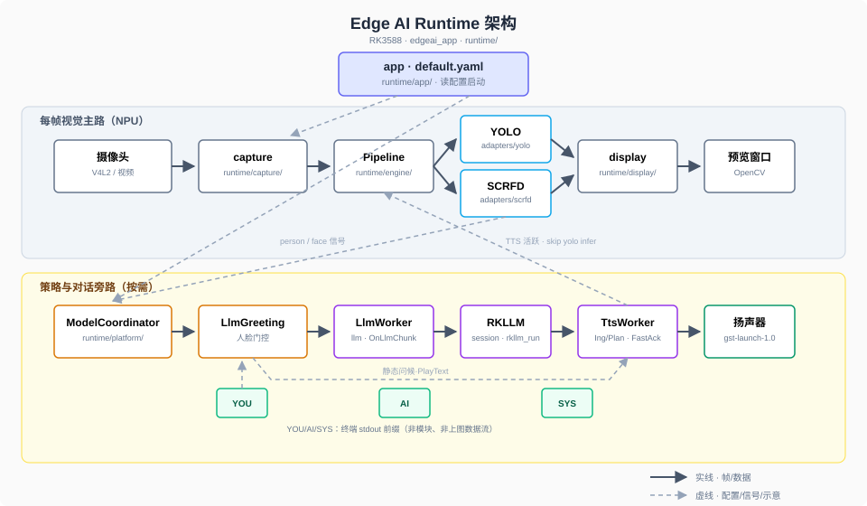

🌐 语言: **中文** | [English](README.md)

# EAI-RK3588：基于插件的边缘AI平台

EAI-RK3588 是为 Rockchip RK3588 / RK3588S 设计的可扩展边缘推理平台。通过一份 YAML 配置文件驱动，结合多线程视频流水线与插件化架构，内置 YOLO、SCRFD 模型，并支持本地 RKLLM 对话及语音合成（TTS）。默认应用展示人员检测 → 人脸识别 → 自动问候 → 语音对话的完整闭环，视觉逐帧推理与 LLM/TTS 旁路线程解耦，互不阻塞。

已在正点原子 RK3588 与野火鲁班猫 RK3588 / RK3588S 上实测通过。

<video src="https://github.com/user-attachments/assets/ecccc336-8c3d-47c2-b277-298a9b517630" controls width="100%"></video>

## 板卡适配

推理层走 Rockchip rknpu，RK3588 / RK3588S 系列板卡通用。代码本身不依赖具体板卡，移植时需要按板端实际情况调整与代码直接相关的几项，包括摄像头节点、摄像头型号、喇叭和编译工具链等，其余部分通用。
> RK3588 的 rknpu / MPP / RGA 驱动只存在于厂商 BSP 内核中。请使用正点原子 或 鲁班猫的官方镜像 / BSP 内核，标准 mainline 内核不带这些驱动。

| 差异项 | 说明 |
|---|---|
| 摄像头节点 | 部署时用 `ls /dev/video*` 查看板端实际节点，填入 `input.source` |
| 摄像头型号 | 实测 MIPI IMX415 与 OV8858 |
| 喇叭 / 音频输出 | 板端音频设备可能不同，按系统实际配置调整 |
| 编译工具链 | 各厂商的交叉编译链和 sysroot 不同，替换 `build-linux.sh` 中的工具链路径与 sysroot |

已实测组合：

- 正点原子 RK3588 + MIPI IMX415
- 野火鲁班猫 RK3588 / RK3588S + MIPI IMX415 / OV8858

香橙派等其它 RK3588 / RK3588S 板卡尚未实测，移植时参考代码脚本调整即可。

## 快速开始

确保 `model/` 下已放入 `.rknn` 与 `.rkllm` 模型文件；缺 `.rkllm` 时自动降级为纯视觉模式。

在仓库根目录先做预检：

```bash
python3 tools/check_config.py    # 校验 YAML 字段类型与范围

./tools/check_models.sh          # 检查模型文件是否就位
```

然后进入 runtime/ 编译并推送：

```bash
# 1. 进入 runtime 目录
cd runtime

# 2. 执行交叉编译脚本（使用正点原子工具链）
./build-linux.sh

# 3. 将编译产物推送到开发板（推送到 /userdata/aidemo，按需修改路径）
adb push install/rk3588_linux_aarch64/rknn_eai_rk3588 /userdata/aidemo

# 4. 进入板端目录并运行
cd /userdata/aidemo/rknn_eai_rk3588
./edgeai_app
```

上面命令使用正点原子工具链。鲁班猫或其他 RK3588 / RK3588S 板卡需按上一节调整工具链路径、摄像头节点和喇叭，其余步骤不变。

## 架构设计



实线是视频帧与推理结果，虚线是 YAML 与人体/人脸信号；LLM 和 TTS 是独立线程的旁路，不参与每帧 Preprocess → Inference → Postprocess 流水线。启动顺序、线程模型与槽位设计见[docs/architecture-and-runtime.zh.md](docs/architecture-and-runtime.zh.md)。

## 配置说明

所有配置集中在 `runtime/config/default.yaml`，每个字段上方都有中文注释和取值范围，改完保存即生效，无需重编译。部署时通常只需要改以下几项：

| 字段               | 默认值                                   | 说明                       |
| :----------------- | :--------------------------------------- | :------------------------- |
| `input.source`     | `/dev/video-camera0`                     | 摄像头设备节点，换板卡必改 |
| `model.yolo.path`  | `./model/yolov5.rknn`                    | YOLO 模型路径              |
| `model.scrfd.path` | `./model/scrfd.rknn`                     | SCRFD 模型路径             |
| `model.llm.path`   | `./model/qwen2.5-1.5b_W8A8_RK3588.rkllm` | RKLLM 模型路径             |

TTS 编码器、解码器和词表的路径字段默认指向 `./model/` 下对应文件，换 TTS 模型时改对应的 `*_path` 字段即可。其余参数包括人脸稳定帧数、问候语文本、TTS 语速与分句策略、NPU 核心数、显示窗口尺寸等，均在文件中按需修改。

## 文档

| 文档                                                        | 内容                                         |
| :---------------------------------------------------------- | :------------------------------------------- |
| [架构与运行时](docs/architecture-and-runtime.zh.md) | 启动顺序、流水线、槽位、线程模型与完整架构图 |
| [TTS 实现](docs/tts-melotts.zh.md)                  | MeloTTS 集成细节与验收指南                   |
| [LLM 协调](docs/llm-model-coordinator.zh.md)        | RKLLM 协调、门控逻辑与终端交互               |
| [适配器说明](docs/adapters.zh.md)                 | yolo / scrfd / llm / tts 各自职责与代码入口  |
| [运行排障](docs/troubleshooting.zh.md)                  | 无框、路径错误、退出崩溃等常见问题           |

## 仓库结构

```text
eai-rk3588/
├── model/                  # yolov5.rknn、scrfd.rknn、.rkllm、TTS encoder/decoder RKNN、lexicon.txt、tokens.txt
├── docs/                   # 架构与运行时、TTS、LLM 协调、插件角色、排障
├── assets/                 # 架构图等静态资源
├── runtime/
│   ├── app/                # main 入口与 console UI
│   ├── engine/             # pipeline、thread_pool
│   ├── platform/           # model_coordinator、llm_greeting
│   ├── capture/            # camera_source、frame_transform
│   ├── display/            # opencv_display_sink、result_overlay
│   ├── adapters/
│   │   ├── yolo/           # yolo_adapter、yolo_postprocess
│   │   ├── scrfd/          # scrfd_adapter、scrfd_postprocess
│   │   ├── llm/            # rkllm_session、llm_worker
│   │   └── melotts/        # melotts_engine、melotts_process、melotts_session
│   ├── voice/              # tts_worker、audio_player、tts_planner、tts_ingress 等
│   ├── 3rdparty/
│   │   ├── rknpu2/         # librknnrt.so、头文件
│   │   ├── rkllm/          # librkllmrt.so、libgomp
│   │   └── timer/          # 计时工具
│   ├── utils/              # imageutils、fileutils、imagedrawing、audioutils
│   ├── config/             # default.yaml
│   ├── build-linux.sh      # 交叉编译脚本
│   └── CMakeLists.txt      # RK3588 交叉编译工具链配置
├── tools/                  # check_config.py、check_models.sh，不参与板端运行
├── LICENSE
├── README.md
└── README.zh.md
```

## License

MIT License